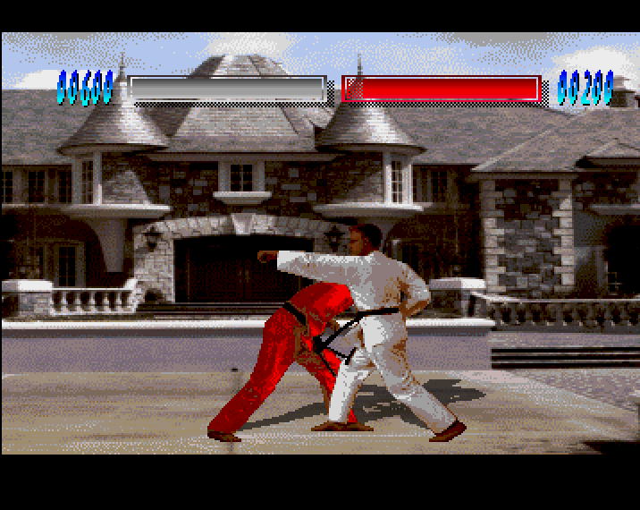
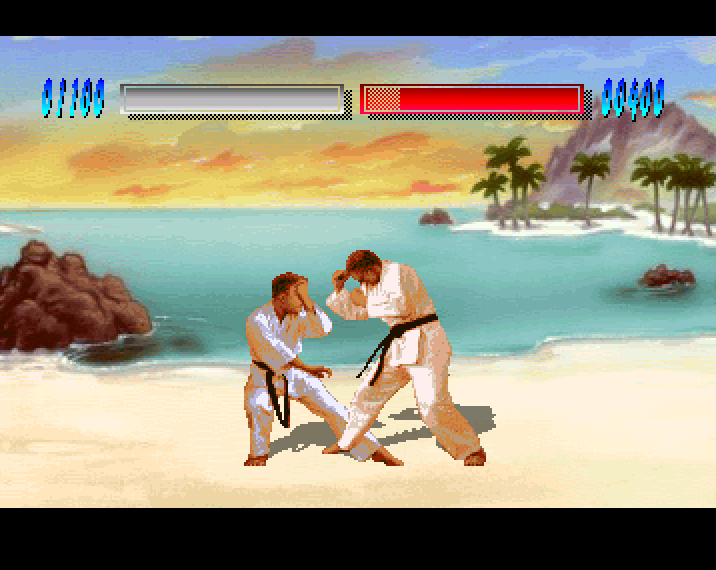
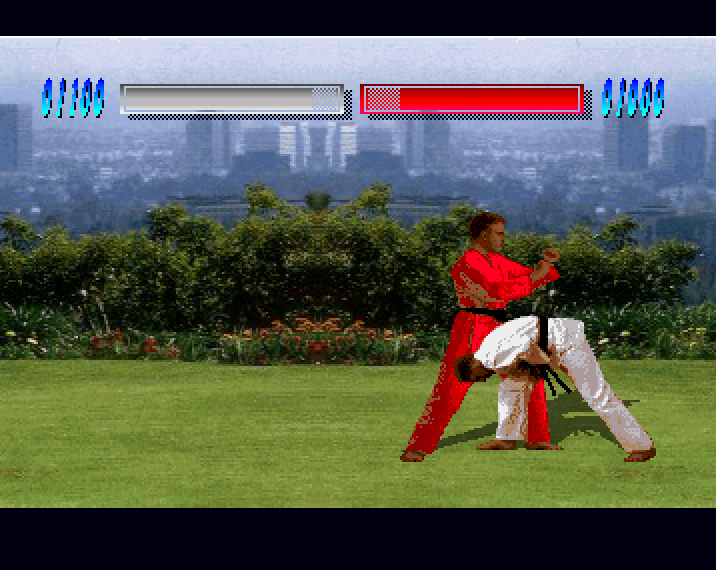
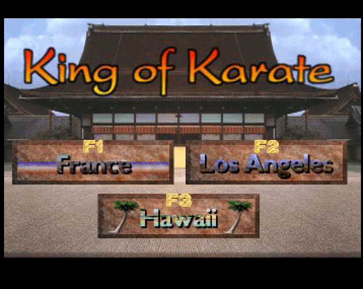
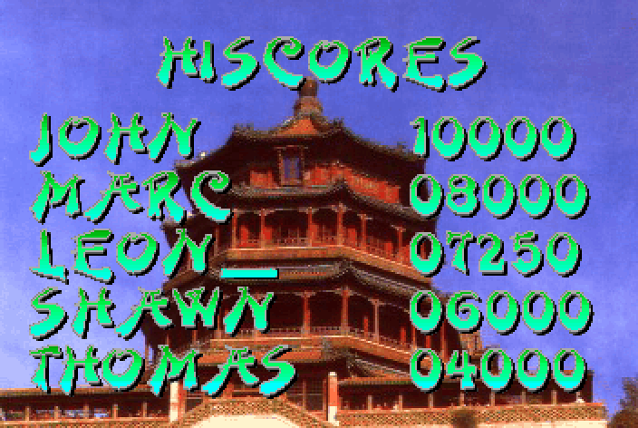

# King of Karate – Chipset patch

**King of Karate** (Centaur, 1992) was bundled with the OpalVision 24-bit video card and showed its
backgrounds only through that card – on a plain Amiga you saw two fighters on a black screen.
This patch converts the OpalVision pictures and patches the game so that **everything is shown by the
Amiga chipset alone**: OCS, ECS or AGA.

| Fight – EHB (OCS/ECS) | Fight – AGA, 256 colours |
|---|---|
|  |  |
|  |  |



> **No game files are included.** You need your own copy of the original game. The patcher checks the
> SHA-256 of your files and builds the patched game from them.

## Features

- **Fights:** scrolling full-height panoramas in **EHB** (64 colours, translucent shadows), **HAM6** or
  **AGA** (256 colours from a 24-bit palette, shadows; A1200/A4000/CD32). Energy bars and scores sit on
  the scenery like in the original; fighters stand at the original height and walk **behind** the
  foreground walls in France (from OpalVision's own priority stencil).
- **Title and high score screens** (with the original pagoda picture) in EHB, HAM6 or AGA.
- **Computer opponent** with three difficulty levels and an unattended **CPU-vs-CPU demo**.
- **Start-up screen** for game mode and difficulty (joystick or cursor keys + Space).
- **Keyboard control** in fights: W/A/S/D + left Shift/Alt and cursor keys + right Shift/Alt
  (works together with joysticks).
- **Amiga+Q** quits to Workbench from anywhere.
- Works on **AGA** machines and with a **relocated VBR** (68010+ accelerators); the original crashes there.
- OpalVision libraries are **not** needed.

## Requirements

| | |
|---|---|
| PC (to patch) | Python 3.8+ and numpy (`pip install numpy`) |
| Amiga, `ehb` / `ham` | OCS/ECS/AGA, 1 MB chip + ~1 MB fast RAM, or 2 MB chip |
| Amiga, `aga` | AGA chipset (A1200 / A4000 / CD32 with HD), 2 MB chip RAM |

## Usage

1. Copy the files of the original game disks into one directory on your PC.
2. Run (the output directory must be a different one):

   ```
   python3 kokpatch.py <original game dir> <output dir> [--mode ehb|ham|aga]
                       [--title-mode ehb|ham|aga]
   ```

   Examples (on Windows use `python` instead of `python3`):

   | Shell | Command |
   |---|---|
   | Windows CMD / PowerShell | `python kokpatch.py C:\KoK_original C:\KoK_AGA --mode aga` |
   | Git Bash (MINGW64) on Windows | `python kokpatch.py /c/KoK_original /c/KoK_AGA --mode aga` |
   | Linux / macOS | `python3 kokpatch.py ~/KoK_original ~/KoK_AGA --mode aga` |

   In Bash a backslash is an escape character – use `/c/...` or `C:/...` paths there.
3. Copy the output directory to the Amiga and start the **KingOfKarate** icon.

See [ReadMe.txt](ReadMe.txt) for controls and details, [CzytajTo.txt](CzytajTo.txt) in Polish.

## How it works

`kokpatch.py` decodes the OpalVision images (`scripts/opal.py`), converts them to EHB/HAM/AGA bitmaps
(`scripts/bgconv.py`) and appends new 68000 code to the original executables, redirecting a few calls
into it. The patch code is in [`patches/`](patches):

| Source | What it does |
|---|---|
| `karate_patch.s` | fight display: copper, scrolling, fighter blitting, shadows, HUD, foreground stencil, CPU opponent, keyboard |
| `title_patch.s` | start-up screen, title picture |
| `hiscore_patch.s` | high score picture with the game's text laid over it |
| `shellfix.s` | AGA register reset, relocated VBR, Amiga+Q, keys (all programs) |
| `loaderfix.s` | clean exit to Workbench, Workbench colours |

`python3 patches/build.py [path to vasmm68k_mot]` rebuilds all `patches/*.bin` from the sources with
[vasm](http://sun.hasenbraten.de/vasm/) – byte for byte identical to the committed binaries.

## Tested on

- A600 + Furia (68EC020), Kickstart 3.1 – EHB, HAM
- A600 68000 + A6095 fast RAM, Kickstart 3.1 – EHB, HAM
- WinUAE, A1200 configuration – AGA

Reports from real A1200 / A4000 / CD32 hardware are welcome.

## Credits

Patch by **Leopold "Leon" Tupalski** (TULAB) and **Claude** (an AI model by Anthropic), working
human-in-the-loop: Claude wrote the 68000 patch code, the graphics converter and the test tools; Leon set
the direction, tested on real hardware and in WinUAE, and caught the bugs.

Original game **King of Karate** © 1992 Centaur – code: Marc Hawlitzeck, graphics: Greg Niles
(Saddleback Graphics), music: Björn Lynne (Cine Sound), title module: DENS Design.

Unofficial fan patch, not affiliated with Centaur or the makers of OpalVision.

## License

The patch code and tools are under the [MIT License](LICENSE). The license does not cover the game itself.
